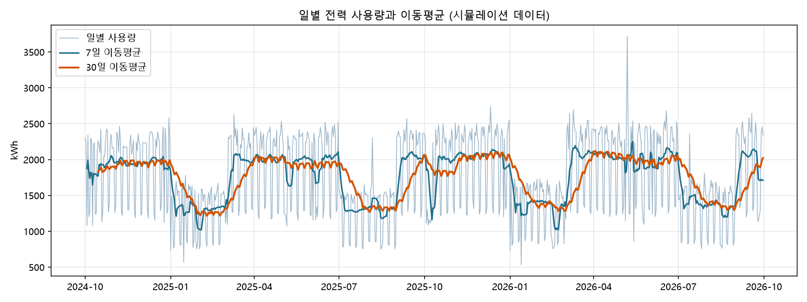
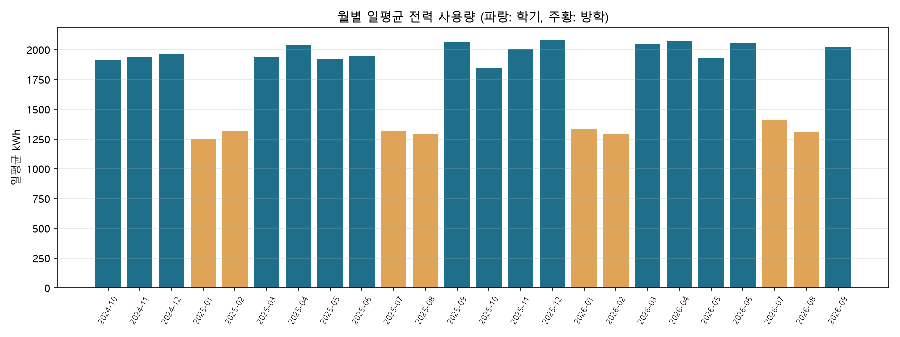
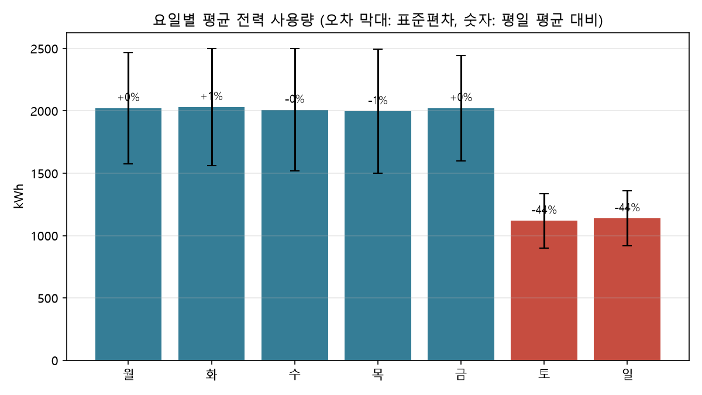
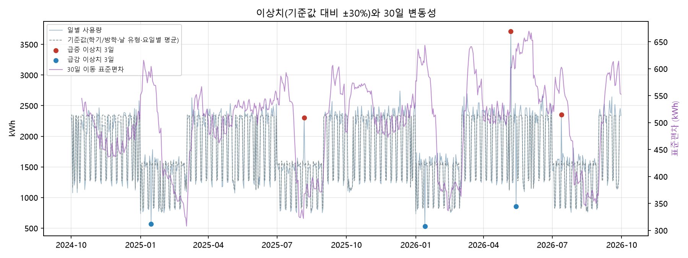
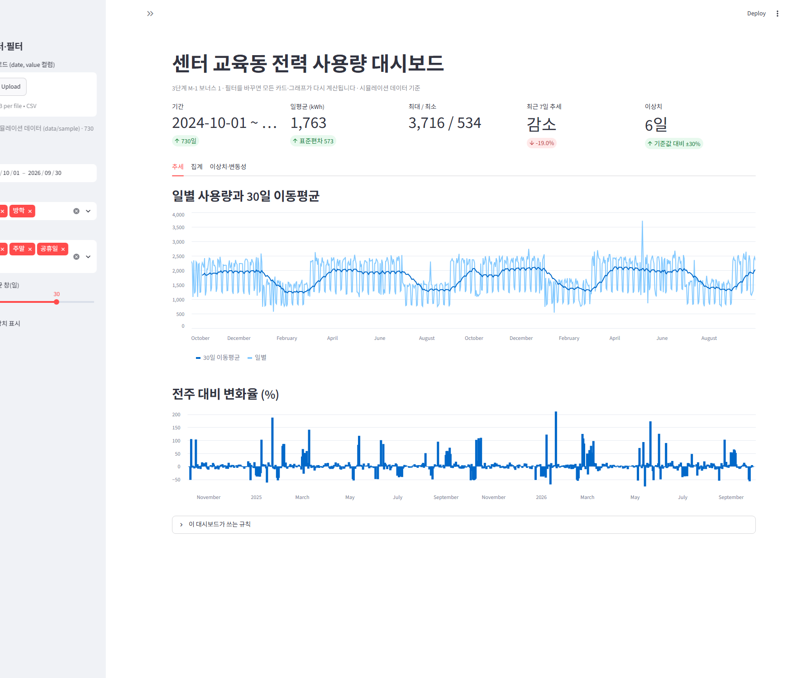
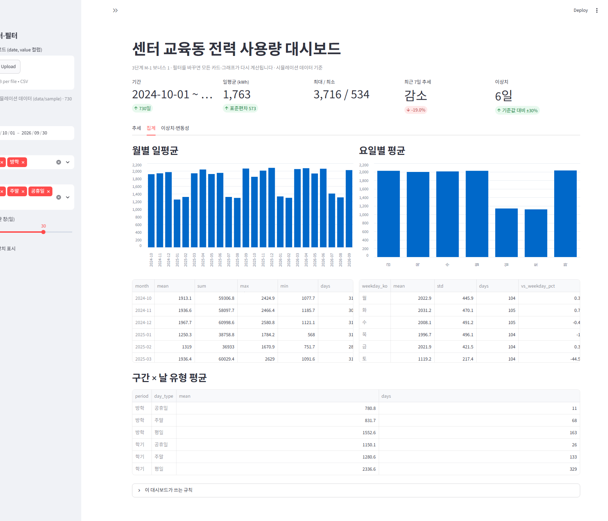
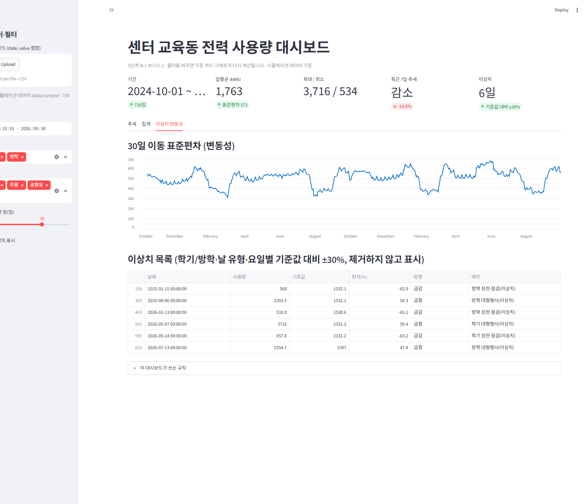
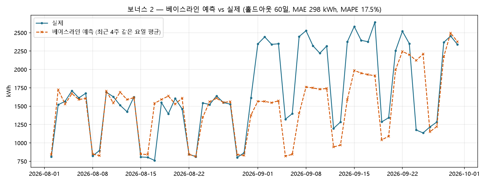
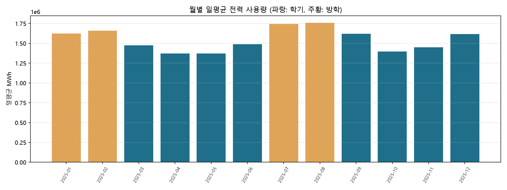
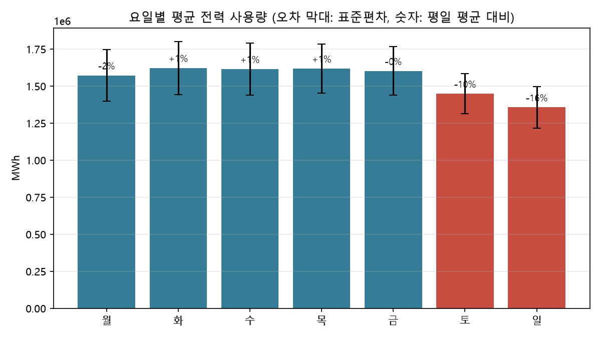

# 센터 교육동 일별 전력 사용량 시계열 분석 — 분석 리포트

3단계 M-1 · 작성일 2026-10-07 · 시나리오: 대학교 에너지인력양성센터 · 코드·데이터: 이 저장소 (`README.md` 재현 방법)

> 수치는 모두 `python src/run.py`가 만든 `output/summary.txt`에서 그대로 옮겼다. 본문의 **관찰(Fact)** 은 그래프·수치에서 확인한 것, **해석(Why)** 은 가설이다. 이 둘을 구분해 적었다.

## 1. 분석 주제와 선정 이유

| 항목 | 내용 |
|---|---|
| 주제 | 에너지인력양성센터가 관리하는 교육동 건물의 **일별 전력 사용량(kWh)** 2년(2024-10-01 ~ 2026-09-30) |
| 왜 이 주제인가 | 센터는 에너지 인력을 기르는 곳이면서 건물 운영비(전기요금)를 직접 관리한다. 1단계 B-3에서 문의 자동화, 2단계 A-3에서 AI 안내 데스크를 만들었고, 이번에는 센터가 **스스로 쓰는 에너지**를 데이터로 본다. 다음 과제 M-2 "센터 운영 비서"가 이 데이터를 알고 답하게 된다 |
| 데이터 형태 | 하루 1점, 730점. 미션 요구(100점 이상) 충족 |
| 데이터 성격 | **시뮬레이션 데이터**(3장). 실제 센터 건물 계량값은 센터 외부에서 받을 수 없어, 공개된 건물 전력 패턴 지식(학기·요일·냉난방)을 규칙으로 옮겨 생성했다. 같은 코드로 실데이터(전력거래소 전국 전력수요)도 분석해 방법이 실데이터에서도 동작함을 7장에서 보인다 |

## 2. 분석 질문 3개

| # | 질문 | 유형 | 쓰는 기법 |
|---|---|---|---|
| Q1 | 학기 중과 방학의 사용량은 얼마나 다른가? | 그래프로 확인 가능 | 월별 집계, 구간 통계 |
| Q2 | 요일 패턴이 있는가? 주말·공휴일은 평일의 몇 %인가? 패턴에서 벗어난 날(이상치)은 언제인가? | 그래프로 확인 가능 + 기준 정의 필요 | 요일별 집계, 이상치 표시, 변동성 |
| Q3 | 기온(냉난방)은 사용량에 얼마나 영향을 주는가? 최근 추세는 증가·감소·유지 중 무엇인가? | 추가 해석 필요 | 이동평균, 변화율, 상관 |

**시계열 구성 요소로 본 이 데이터와 기법 선택 이유**

| 구성 요소 | 이 데이터에서 | 보는 기법 | 왜 이 기법인가 |
|---|---|---|---|
| 추세(trend) | 연 +3% 완만한 증가(장비 증설 가정) | 30일 이동평균, 연도별 고점 비교 | 30일 창은 요일 주기(7일)와 공휴일 효과를 평활해 "수준"만 남긴다 |
| 계절성(seasonality) | 연 주기: 학기/방학 · 주 주기: 평일/주말 | 월별·요일별 집계, 구간 통계 | 주기가 정확히 알려진 경우 집계가 가장 직접적인 정량화다 |
| 노이즈(noise)·사건 | 일상 변동(±4%) + 정전·행사 | 전일·전주 대비 변화율, 30일 이동 표준편차, 이상치 규칙 | 변화율은 사건 "시점"을, 변동성은 "불안정 구간"을 보여 준다. 7일 이동평균은 주 주기만 제거해 학기 전환 시점을 또렷하게 한다 |

## 3. 데이터 설명

| 항목 | 값 |
|---|---|
| 파일 | `data/sample/electricity_daily.csv` |
| 출처 | `make_sample.py`로 생성한 **시뮬레이션 데이터** (seed 260000, 규칙은 `data/README.md`) |
| 기간 · 개수 | 2024-10-01 ~ 2026-09-30 · 730일 (결측 0) |
| 컬럼 | `date`(일자), `value`(kWh), `temp_c`(일평균 기온 ℃), `is_holiday`(0/1), `memo`(학기/방학·주말·공휴일·이상치 표시) |
| 기초 통계 | 평균 1,763.3 / 최소 533.9 / 최대 3,716.0 / 표준편차 573.0 kWh |
| 라이선스 | 생성 데이터라 제한 없음. 실데이터(7장)는 공공데이터포털 전력거래소 자료, 이용허락범위 제한 없음(`data/real/source.md`) |

집계 단위: **일 단위**를 기본으로 한다. 원 데이터가 일별 계량값이고, Q2(요일·이상치)는 일 단위에서만 보이기 때문이다. Q1은 월별로 집계해 본다(학기/방학이 월 단위로 바뀜). 주 단위는 요일 효과와 공휴일 효과가 섞여 쓰지 않았다.

생성 규칙 요약: 기본 1,800 kWh, 학기 ×1.25 / 방학 ×0.80, 주말 ×0.55, 공휴일 ×0.50, 26℃ 초과·5℃ 미만에서 1℃당 +1.5%, 연 +3% 추세, 노이즈 4%, 평일 6일에 이상치(정전 ×0.35 3일, 대형 행사 ×1.60 3일). **분석 코드는 이 규칙을 모른다.** 분석이 규칙을 되찾아내는지가 방법 검증의 기준이다.

## 4. 전처리 기준

| 항목 | 기준 | 이번 데이터 결과 |
|---|---|---|
| 날짜 | 오름차순 정렬, 중복 날짜는 평균, 빠진 날짜는 행을 만들어 결측으로 둠 | 중복·빠진 날짜 없음 |
| 결측치 | **연속 3일 이하만 선형 보간**, 그보다 긴 구간은 결측 유지(긴 공백을 선으로 메우면 가짜 패턴이 생김) | 결측 0 → 보간 0 |
| 이동평균·변동성의 첫 구간 | 창이 덜 차서 생기는 빈 값은 데이터가 빠진 것이 아니므로 **보간하지 않는다.** 창의 절반이 쌓인 날부터 쌓인 날만으로 계산한다(7일 선은 3일, 30일 선·30일 변동성은 15일) | 7일 선은 2024-10-03, 30일 선·변동성은 2024-10-15부터 값이 있다(그림 1의 30일 선 시작점) |
| 이상치 | **제거하지 않고 표시만 한다.** 기준값 = (학기/방학 × 날 유형 × 요일) 평균, 기준값 대비 ±30% 벗어나면 이상치 | 6일 검출(5-3절) |
| ±30%를 고른 이유 | 학기 평일 329일의 표준편차는 160 kWh로 평균 2,337의 약 7%다(이상치 2일을 빼면 115 kWh, 약 5%). ±30%는 이 평소 흔들림의 4~6배라 보통 날은 걸리지 않고, 정전(−63~−65%)과 행사(+47~+59%)는 여유 있게 걸린다. 결과 6일이 메모와 모두 맞아 이 폭을 유지했다 | 평소 흔들림 5~7%, 이상치 47~65% |
| 기준값 묶음이 작을 때 | 같은 (학기/방학·날 유형·요일)의 날이 4일보다 적으면 평균이 불안정하므로 요일을 빼고 (학기/방학·날 유형) 평균을 기준값으로 쓴다(`src/analyze.py` `flag_outliers`의 `min_group=4`) | 공휴일 37일 중 20일(방학 11·학기 9)이 해당, 이상치 0 |
| 이상치 기준을 바꾼 이유 | 처음에는 "같은 요일 평균 대비 ±30%"로 했더니 **56일**이 잡혔다. 방학과 공휴일이 전부 이상치가 된 것이다. 방학날이 학기 요일 평균보다 낮은 건 이상이 아니라 정상이다. 그래서 같은 조건(학기/방학·날 유형·요일)끼리 비교하도록 기준값을 바꿨고, 심어 둔 6일만 정확히 잡혔다 | 56일 → 6일 |
| 구간 정의 | 학기 = 3~6월·9~12월, 방학 = 1~2월·7~8월. 날 유형 = 공휴일 > 주말 > 평일 | — |

## 5. 분석 결과와 시각화

### 5-1. 추세: 일별 사용량과 이동평균 (그림 1)



**관찰**
- 30일 이동평균은 학기(약 2,000 kWh)와 방학(약 1,300 kWh) 두 수준을 오간다. 매년 1~2월, 7~8월에 골이 생긴다.
- 7일 이동평균은 학기 시작(3월·9월 초)에 1~2주 만에 1,300 → 2,000 kWh로 올라간다. 전환이 완만하지 않고 계단형이다.
- 두 번째 해의 30일 이동평균 고점(2026-04 약 2,070)이 첫해(2025-04 약 2,040)보다 조금 높다.

**해석**: 사용량의 큰 흐름은 학사 일정이 정한다. 기온보다 "사람이 건물에 있는가"가 먼저다. 두 번째 해가 조금 높은 것은 장비 증가 같은 완만한 추세일 수 있으나 1년 차이로 단정할 수 없다(8장 한계).

### 5-2. Q1 학기 vs 방학: 월별 집계 (그림 2)



| 구간 | 일평균 (kWh) | 비교 |
|---|---|---|
| 학기(3~6, 9~12월) | 1,985.6 | 기준 |
| 방학(1~2, 7~8월) | 1,315.0 | 학기가 **+51.0%** |

월별 일평균: 2024-10 1,913 · 11 1,937 · 12 1,968 · 2025-01 1,250 · 02 1,319 · 03 1,936 · 04 2,037 · 05 1,918 · 06 1,947 · 07 1,318 · 08 1,292 · 09 2,061 · 10 1,845 · 11 2,006 · 12 2,080 · 2026-01 1,332 · 02 1,295 · 03 2,048 · 04 2,070 · 05 1,933 · 06 2,058 · 07 1,406 · 08 1,306 · 09 2,021

**관찰**: 방학 4개월은 모두 1,250~1,410, 학기 8개월은 모두 1,845~2,080. 두 집단이 겹치지 않는다. 학기 중에서는 2025-10(1,845)과 2026-05(1,933)가 낮다.
**해석**: 2025-10은 추석 연휴 4일(10-05~08)과 개천절·한글날이 들어 있어 낮다. 2026-05은 어린이날·부처님오신날·대체공휴일에 더해 이상치 2일(05-07 행사 +59%, 05-14 정전 −63%)이 들어 있다. 즉 학기 중 월 차이는 공휴일 수로 대부분 설명된다.

### 5-3. Q2 요일 패턴과 이상치 (그림 3, 4)



| 날 유형 | 일평균 (kWh) | 평일 대비 |
|---|---|---|
| 평일 | 2,076.9 | 100% |
| 주말 | 1,128.7 | 54.3% |
| 공휴일 | 1,040.3 | 50.1% |

요일별: 월 2,023(+0%) 화 2,031(+1%) 수 2,008(−0%) 목 1,997(−1%) 금 2,022(+0%) 토 1,119(−44%) 일 1,138(−44%)

**관찰**: 평일 5일은 ±1% 안에서 같다. 토·일은 평일 요일 평균의 56%(요일별 표, 월~금 평균에 공휴일이 포함됨), 날 유형으로 나누면 주말은 평일의 54%, 공휴일은 50%(위 표, 공휴일을 평일에서 뺀 값). 오차 막대(표준편차)는 평일이 주말보다 크다(학기/방학이 섞여서).
**해석**: 주말에도 절반이 쓰이는 것은 서버·냉장·대기전력·보안 등 "사람이 없어도 도는 부하"가 평일 사용량의 절반쯤 된다는 뜻으로 읽을 수 있다. 이것이 맞다면 절감 여지는 주말 기저 부하에 있다(6장 인사이트 2).



| 날짜 | 방향 | 기준값 대비 | 메모 |
|---|---|---|---|
| 2025-01-15 | 급감 | −63% | 정전·점검 |
| 2025-08-06 | 급증 | +50% | 대형 행사 |
| 2026-01-13 | 급감 | −65% | 정전·점검 |
| 2026-05-07 | 급증 | +59% | 대형 행사 |
| 2026-05-14 | 급감 | −63% | 정전·점검 |
| 2026-07-13 | 급증 | +47% | 대형 행사 |

**관찰**: 이상치 6일 모두 평일이며, 급감 3일·급증 3일. 공휴일·주말은 하나도 이상치로 잡히지 않았다. 30일 이동 표준편차는 평균 503, 최대 669.8(2026-05-31)로 학기·방학 **전환 구간**과 급증 이상치 직후에 치솟는다.
**해석**: 변동성이 큰 구간은 "값이 불안정한 때"가 아니라 "수준이 바뀌는 때"다. 변동성 지표만 보고 이상을 판단하면 전환기를 오해한다. 이상치는 메모(정전·행사)와 일치하므로 기준이 적절했다고 본다.

### 5-4. Q3 기온과 최근 추세

| 지표 | 값 |
|---|---|
| 평일 492일 기온–사용량 상관(피어슨 r) | −0.062 |
| \|기온 − 18℃\| 와의 상관 (전체 평일) | **−0.346** |
| 같은 지표, **학기 평일만** | **+0.197** |
| 같은 지표, **방학 평일만** | +0.134 |
| 학기 평일 구간 평균: 난방(<5℃) / 중간 / 냉방(>26℃) | 2,385.7 / 2,321.8 / 2,431.7 |
| 방학 평일 구간 평균 | 1,563.6 / 1,523.1 / 1,556.2 |
| 최근 7일 평균 vs 직전 7일 | 1,710.7 vs 2,111.0 → **감소(−19.0%)** |
| 최대 일변화 | 2026-01-14 전일 대비 206.1% (정전 다음 날 복귀) |

**관찰**: 전체 평일로 보면 기온이 18℃에서 멀어질수록 사용량이 **낮아진다**(r = −0.346). 그런데 학기만 보면 **높아진다**(+0.197). 학기 평일에서 냉방 구간은 중간 구간보다 +4.7%, 난방 구간은 +2.8%다.
**해석**: 전체 상관이 음수인 이유는 "더운 날 = 7~8월 = 방학"이기 때문이다. 기온 효과가 방학 효과에 묻혔다. 구간을 나누면 냉난방 효과가 작지만 양(+)으로 드러난다. 이것이 이 리포트에서 **관찰과 해석을 구분해야 하는 가장 중요한 지점**이다. 그래프 하나(전체 상관)만 보고 "기온은 사용량과 관계없다"고 쓰면 틀린다.
**최근 추세**: 마지막 7일(2026-09-24~30)에 추석 연휴 3일이 들어 있어 감소로 나온다. 학사 일정을 모르는 규칙(최근 7일 vs 직전 7일)의 한계이며, M-2 비서가 추세를 말할 때 공휴일 주의 문구를 넣어야 하는 근거다.

## 6. 인사이트 (Fact → Why → Action)

| # | Fact (그래프·수치 근거) | Why (해석·가설) | Action (센터가 할 일) |
|---|---|---|---|
| 1 | 학기 일평균 1,985.6 vs 방학 1,315.0, **+51%**. 월별 집계에서 두 집단이 겹치지 않음 (그림 2) | 사용량의 주 결정 요인은 학사 일정(재실 인원) | 전기요금 예산을 월 균등이 아니라 **학기 8개월 : 방학 4개월 = 60 : 40** 비율로 잡는다. 계약전력 검토는 학기 피크(4월·12월) 기준으로 |
| 2 | 주말 1,128.7 kWh = 평일의 **54%**, 공휴일 50% (그림 3). 사람이 거의 없는 날에도 절반이 쓰임 | 서버·냉장·대기전력 같은 **기저 부하**가 평일의 절반 | 주말 하루를 골라 분전반별 계측(또는 야간 순찰 기록)으로 기저 부하 구성을 확인하고, 끌 수 있는 것(교육용 PC·프로젝터 대기전력)을 찾는다. 기저 부하 10%만 줄여도 주말·공휴일 연 약 120일(2025년: 주말 102 + 공휴일 18) × 약 110 kWh ≈ 연 1만 3천 kWh |
| 3 | 이상치 6일 중 급감 3일(−63~−65%)은 정전·점검, 급증 3일(+47~+59%)은 행사. 기준값 대비 ±30% 규칙이 메모와 100% 일치 (그림 4, 표) | 평상시 패턴을 (구간·날 유형·요일)로 정의하면 이상 감지가 단순 규칙으로 가능 | M-2 비서에 같은 규칙을 넣어 "어제 사용량이 기준값보다 30% 이상 벗어났다"를 자동 안내. 행사가 예정된 날은 memo를 미리 넣어 오탐을 막는다 |
| 4 | 전체 평일 기온 상관 −0.346, 학기만 보면 +0.197. 학기 냉방 구간 +4.7%, 난방 +2.8% (5-4 표) | 기온 효과는 존재하지만 작고, 구간을 나누지 않으면 부호가 뒤집혀 보임 | 냉난방 절감 캠페인의 기대 효과는 **학기 평일 사용량의 3~5%** 수준으로 보수적으로 잡는다. 기온 분석은 반드시 학기/방학을 나눠 보고한다 |

## 7. 보너스

### 7-1. 보너스 1 — Streamlit 대시보드 (`app.py`)





- 사이드바: 기간, 구간(학기/방학), 날 유형(평일/주말/공휴일), 이동평균 창(7·14·30·60), 이상치 표시, CSV 업로드
- 상단 카드 5개(기간·일평균·최대/최소·최근 7일 추세·이상치 수), 탭 3개(추세 / 집계 / 이상치·변동성)
- 계산은 `src/analyze.py`를 그대로 호출하므로 리포트와 같은 숫자가 나온다
- 제출 방식: 미션 선택지 (3) 스크린샷 세트 + 아래 필터 변경 시나리오. 배포는 하지 않았다

필터 변경 시나리오 예(헤드리스 실행으로 확인한 값): 구간을 "학기"만, 날 유형을 "평일"만 고르면 일평균 카드가 1,763 → 2,337(학기 평일 329일)로 바뀌고 표준편차가 573 → 160으로 줄며(주말·방학 변동이 빠짐), 이상치 카드는 6일 → **2일**(2026-05-07 행사, 05-14 정전)이 된다. "방학"만 고르면(242일) 일평균 1,315, 이상치 **4일**(나머지 정전 2·행사 2)이고 집계 탭의 요일별 그래프에서 주말 비율은 그대로 보인다. 이상치는 전체 데이터로 한 번 계산한 뒤 필터로 걸러 보여 주므로, 필터를 바꿔도 기준값은 변하지 않는다.

### 7-2. 보너스 2 — 베이스라인 예측 (`src/forecast.py`, 그림 5)



| 방법 | 홀드아웃 | MAE (kWh) | MAPE |
|---|---|---|---|
| 같은 요일 직전 4주 평균 | 마지막 60일 | 297.6 | 17.5% |
| 비교: naive-7 (전주 같은 요일 값) | 마지막 60일 | 237.4 | 15.9% |

**가정**: 요일 패턴이 4주 안에서 유지된다. 학기·방학 전환, 공휴일, 정전은 모른다.
**결과 해석**: 더 단순한 naive-7이 4주 평균보다 **나았다**. 홀드아웃 구간(2026-08-02~09-30)에 방학→학기 전환(9월 초)이 들어 있어, 4주 평균은 방학 값을 끌고 와 9월을 체계적으로 낮게 예측했다. 전주 값은 전환을 1주 만에 따라잡는다. 정확도가 목적이 아니라도 "평균을 길게 잡을수록 좋다"는 직관이 전환기에서는 틀린다는 점을 확인했다.
**한계**: 단일 수치 예측(불확실성 구간 없음), 공휴일·이상치 날 오차가 큼. 다음 단계는 학사 일정(학기/방학 플래그)과 공휴일을 입력으로 쓰는 모델이다.

### 7-3. 실데이터 교차 검증 — 전력거래소 전국 전력수요 2025 (`output/real/`, `images/real/`)

같은 코드를 **실데이터**에 돌렸다. 공공데이터포털의 전력거래소 "시간별 전국 전력수요량"(2025-01-01~12-31, 24개 시간 열, MWh)을 `src/convert_kpx.py`로 일별 합계 365점으로 바꿨다.

| 지표 | 결과 | 시뮬레이션과 비교 |
|---|---|---|
| 일평균 | 1,548,078 MWh (최소 1,102,877 / 최대 1,938,321) | 규모만 다름 |
| 월별 | 1~2월 1.62~1.66M, 7~8월 1.75~1.76M **높음**, 4~5월·10월 1.37~1.40M 낮음 | **반대 패턴**: 전국 수요는 냉난방이 지배해 여름·겨울이 높다. 건물 시뮬레이션은 재실 인원(학기)이 지배 |
| 요일 | 토 −10%, 일 −16%, 공휴일 82% | 건물(주말 54%)보다 주말 감소가 훨씬 작음. 전국에는 24시간 산업 부하가 있음 |
| 이상치 | 0일 | 전국 합계는 평활해 ±30% 벗어나는 날이 없음 |
| 베이스라인 예측 | 4주 평균 MAPE 4.6%, naive-7 3.1% | 역시 naive-7이 우세 |




**배운 점**: ① 코드는 실데이터에서 수정 없이 동작했다(인코딩 cp949 자동 판별, 컬럼 자동 탐색). ② "학기/방학" 구간 라벨은 전국 수요에 의미가 없으므로 라벨을 데이터에 맞게 바꿔야 한다(현재는 월 기준 고정). ③ 시뮬레이션의 "학기가 높다"는 결론은 **건물 단위**에서만 성립하며, 상위 집계(전국)에서는 기온이 지배한다. 분석 단위가 바뀌면 지배 요인이 바뀐다.

## 8. 결론과 한계

**결론**
1. 교육동 사용량은 학사 일정이 1차로 정하고(학기 +51%), 요일이 2차로 정한다(주말 54%). 기온 효과는 그 아래에서 3~5%다.
2. 주말·공휴일에도 평일의 절반이 쓰이는 기저 부하가 가장 큰 절감 후보다.
3. (구간 × 날 유형 × 요일) 기준값 대비 ±30% 규칙으로 정전·행사를 모두 잡았고 오탐이 없었다. 이 규칙을 M-2 비서에 넣는다.
4. 분석 기법 4가지(이동평균·변화율·집계·변동성) 중 질문에 가장 직접 답한 것은 **집계**였고, 이동평균은 전환 시점을, 변동성은 전환 구간을 보여 주는 보조 역할이었다.

**한계**
- 데이터가 시뮬레이션이다. 결론 1~3은 "이런 규칙으로 만든 데이터에서 분석 방법이 규칙을 되찾았다"는 **방법의 검증**이지 센터 건물의 사실이 아니다. 실제 계량 데이터로 교체하면(`data/README.md` 4절) 수치는 달라진다.
- 2년치라 "연 +3% 추세"를 통계적으로 확인하기 어렵다. 1년 차이는 노이즈와 구분되지 않는다.
- 기온은 모델로 생성한 값이다. 실데이터에서는 기상청 일평균 기온을 붙여야 한다.
- 최근 추세 규칙(7일 vs 7일)은 공휴일을 모른다. 운영에 쓰려면 공휴일을 제외한 영업일 기준으로 바꿔야 한다.
- 실데이터 검증은 전국 단위라 건물 분석의 결론을 직접 검증하지 못한다. 건물 단위 실데이터(예: 한전 개방포털 계약종별, 로그인 필요)는 사용자가 확보해야 한다.

**반례 — 조건을 바꾸면 결론이 달라지는 경우** (본문에 나온 결과를 모은 것)
- 다른 집계 범위: 전체 평일로 보면 기온과 사용량의 상관이 −0.346이지만 학기 평일만 보면 +0.197이다(5-4). 범위를 나누지 않으면 "기온은 관계없다"는 반대 결론이 나온다.
- 다른 기간(월): 2025-10(1,845)과 2026-05(1,933)는 같은 해 학기 달 가운데 가장 낮다. 추석 연휴·공휴일·이상치가 낀 달이다(5-2). "학기면 높다"는 공휴일 수가 비슷한 달끼리 비교할 때 맞다.
- 다른 기간(최근 7일): 마지막 7일은 추석 연휴 3일 때문에 −19.0% 감소로 나온다(5-4). 연휴가 낀 주의 추세는 사용 습관이 바뀐 것이 아니다.
- 다른 분석 단위: 같은 코드를 전국 전력수요에 돌리면 여름·겨울이 높은 반대 패턴이 나오고, 주말 감소도 10~16%로 작다(7-3). 결론 1·2는 건물 단위에서만 성립한다.

## 9. AI 사용 로그 (의무)

| 작업 | AI 코딩 도구에게 맡긴 것 | 왜 맡겼나 | 어떻게 검증했나 |
|---|---|---|---|
| 데이터 생성기 | 학기·요일·공휴일·기온 규칙을 코드로 옮기기 | 규칙은 내가 정하고 반복 코드는 도구가 빠름 | 생성 결과 요약(평균 1,763, 최소 534, 최대 3,716)이 규칙에서 기대한 범위(1,800 × 0.8 × 0.5 ≈ 720 ~ 1,800 × 1.25 × 1.6 ≈ 3,600)인지 확인. 이상치 6개가 memo에 표시됐는지 grep으로 확인 |
| 분석 모듈 | 이동평균·변화율·집계·변동성·이상치 함수 | 표준 기법이라 코드 정확성이 중요 | **pytest 9개**: 상수 시리즈의 이동평균 = 상수, 100→200은 +100%, 주말 500/평일 1,000이면 −50%, 결측 2일은 보간·5일은 유지, 완전 주기 데이터에서 베이스라인 MAE = 0 등 |
| 이상치 기준 | 처음 제안("같은 요일 평균 ±30%")을 그대로 실행 | — | 결과 56일을 보고 **내가** 기준이 틀렸다고 판단(방학이 전부 잡힘). 기준값을 (구간·날 유형·요일)로 바꾸게 하고, 심은 6일만 나오는지 재확인 |
| 기온 분석 | 상관 계산과 구간 평균 | 계산 자체는 단순 | 전체 상관이 음수로 나와 이상하다고 보고 **학기/방학 분리**를 추가 요청. 분리 후 부호가 바뀐 것을 5-4에 그대로 기록(관찰 vs 해석) |
| 시각화 | matplotlib 5장, 한글 폰트 | 반복 작업 | 그림을 직접 열어 한글 깨짐·범례·단위 확인. 그림 4의 기준값 라벨이 바뀐 규칙과 맞는지 확인 |
| 실데이터 확보 | 로그인 없이 받을 수 있는 공공 전력 CSV 탐색 | 13개 사이트를 사람이 돌기엔 오래 걸림 | 받은 파일의 연 합계(565 TWh)가 한국 연간 전력수요 규모와 맞는지 확인, 365행·24열 구조 확인 |
| 리포트 문장 | 초안 작성 | — | 모든 수치를 `output/summary.txt`와 대조. 해석 문장은 "가설"로 표시. AI가 쓴 "확실하다"류 표현은 지움 |
| 대시보드 | Streamlit 코드, 헤드리스 캡처 | — | 캡처 3장을 열어 카드 수치(1,763 / 6일 / 감소 −19%)가 summary.txt와 같은지 확인 |

## 10. 재현 방법

```
python -m venv .venv && .\.venv\Scripts\Activate.ps1
pip install -r requirements.txt            # 정확한 버전은 requirements-lock.txt
python make_sample.py                      # data/sample/electricity_daily.csv 재생성 (같은 seed → 같은 파일)
python src/run.py --source sample          # images/01~05, output/summary.json·txt
python -m pytest tests -q                  # 9 passed
streamlit run app.py                       # 보너스 1
python src/convert_kpx.py "data/real/한국전력거래소_시간별 전국 전력수요량_20251231.csv" data/real/kpx_daily_2025.csv
python src/run.py --source real --file data/real/kpx_daily_2025.csv --tag real --unit MWh   # 7-3 실데이터
```

환경: Windows 11, Python 3.14.7, pandas 3.0.6, matplotlib 3.11.2, streamlit 1.65.0, scikit-learn 1.9.1(설치만, 미사용), pytest 9.1.1.

## 11. 미션 요구사항 대조표

미션 원문(PDF 7쪽: 1 미션 소개 · 2 최종 결과물 · 3 과제 목표 · 4 기능 요구 · 5 보너스 · 6 개발 환경 · 7 제약 · 8 결과 예시) 전 항목과 이 저장소를 대조했다. ✅ 완료 · ⬜ 미완.

### 2. 최종 결과물

| # | 요구 | 이 저장소 | 상태 |
|---|---|---|---|
| 1 | 분석 리포트 Markdown, 100개 이상 포인트, 주제·질문·데이터·시각화·인사이트·결론/한계 | `REPORT.md` 1~8장, 730점 | ✅ |
| 2 | 시각화 2개 이상(권장 3개 이상), png를 리포트에 포함, 링크 정상 동작 | 그림 5장(5·7장) + 대시보드 3장 + 실데이터 2장 = 10장, 로컬 링크 확인 | ✅ |
| 3 | Python 코드(.ipynb 또는 .py), 원본 데이터 또는 수집 스크립트 | `src/*.py` 6개, `make_sample.py`(생성 스크립트), `data/sample/`·`data/real/` 원본 | ✅ |
| 4 | GitHub 저장소: 코드·리포트·데이터(또는 수집 방법 문서) | [`codyssey_m1`](https://github.com/etu9317cw/codyssey_m1), `data/README.md`·`data/real/source.md` 수집 방법 | ✅ |

### 3. 과제 목표 (스스로 설명할 것)

| # | 목표 | 리포트 위치 | 상태 |
|---|---|---|---|
| 1-1 | 질문 3개 이상 정의 | 2장 Q1~Q3 | ✅ |
| 1-2 | 결측치/이상치 정의와 처리 기준 | 4장(보간 3일 규칙, 이동평균 첫 구간, 기준값 ±30%와 그 이유, 작은 묶음의 기준값, 기준을 바꾼 이유) | ✅ |
| 1-3 | 관찰과 해석 구분 | 5장 모든 절 "관찰/해석" 분리, 5-4 기온 부호 반전 사례 | ✅ |
| 2-1 | 트렌드/계절성/노이즈 개념 | 2장 구성 요소 표, 3장 생성 규칙(추세 +3%·계절성·노이즈 4%) | ✅ |
| 2-2 | 이동평균·변화율을 왜/어떻게 적용했나 | 2장 표, 5-1·5-4, 8장 결론 4 | ✅ |
| 3-1 | AI에게 질문하고 생성 코드·해석 검증 | 9장(pytest 9개, 이상치 기준 재검토, 기온 분리 요청) | ✅ |
| 3-2 | 최종 판단은 본인이 근거를 들어 | 6장 Fact → Why → Action, 8장 결론 | ✅ |

### 4. 기능 요구 사항

| # | 요구 | 이 저장소 | 상태 |
|---|---|---|---|
| 1 | 시계열 1개, 100개 이상, 출처·기간 명시 | 일별 전력 730점, 3장 출처(시뮬레이션 명시)·기간 | ✅ |
| 2 | 질문 3개 이상, 그래프 확인형·해석형 혼합 | 2장: 확인형 2 + 해석형 1 | ✅ |
| 3 | 기본 정보(기간·컬럼·결측) 확인, 결측/이상치 기준, 기법 2가지 이상 | 3장 표, 4장, 기법 4가지(이동평균·변화율·집계·변동성) | ✅ |
| 4 | 시각화 2개 이상(권장 3개) | 5장 그림 1~4 + 7장 그림 5 | ✅ |
| 5 | 인사이트 3개 이상, 각각 관찰 수치 포함, REPORT.md 구성 | 6장 4개(모두 수치·그림 번호 인용) | ✅ |

### 5. 보너스 · 6. 개발 환경 · 7. 제약 · 8. 결과 예시 가이드

| 구분 | 요구 | 이 저장소 | 상태 |
|---|---|---|---|
| 보너스 1 | 기간/조건을 바꿔 탐색하는 대시보드, 제출 (1)~(3) 택1 | `app.py`(기간·구간·날 유형·창·이상치·CSV), 선택지 (3) 스크린샷 세트 + 7-1 시나리오 설명 | ✅ |
| 보너스 2 | 분해(A) 또는 예측(B) 1개 이상 + 시각화 1개 | (B) 베이스라인 예측, 그림 5, 가정·한계 서술 | ✅ |
| 개발 환경 | Python 3.10 이상, .ipynb 또는 .py | Python 3.14.7, .py | ✅ |
| 제약·재현성 | 의존성 목록 | `requirements.txt` + `requirements-lock.txt` | ✅ |
| 제약·재현성 | 실행 방법을 README 또는 리포트에 | README 설치·실행, 10장 재현 방법 | ✅ |
| 제약·재현성 | 데이터 출처/수집 방법/라이선스 주의 문구 | 3장, `data/README.md` 5절, `data/real/source.md` | ✅ |
| 제약·분석 품질 | 그래프만 나열 금지, 관찰(근거)/해석(가설) 구분 | 그림마다 관찰·해석 문단 | ✅ |
| 제약·AI 투명성 | "AI 사용 로그" 섹션에 작업·이유·검증 방법 | 9장 표(8개 작업 × 3열) | ✅ |
| 결과 예시 가이드 | 시간 축 정렬·누락 구간 확인 | `load.py` 정렬·빠진 날짜 채움, 4장 | ✅ |
| 결과 예시 가이드 | 스케일 점검 | 값 범위 534~3,716으로 넓어 자동 범위에서 변화가 평평해지지 않음(그림 1·4). 막대 그래프(그림 2·3)는 0부터. 실데이터는 단위 MWh를 분리해 별도 그림 | ✅ |
| 결과 예시 가이드 | 집계 단위 선택 근거 한 줄 | 3장 "집계 단위" | ✅ |
